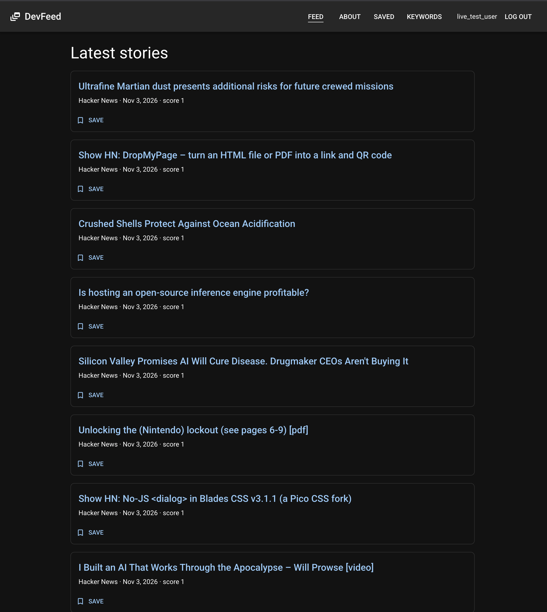
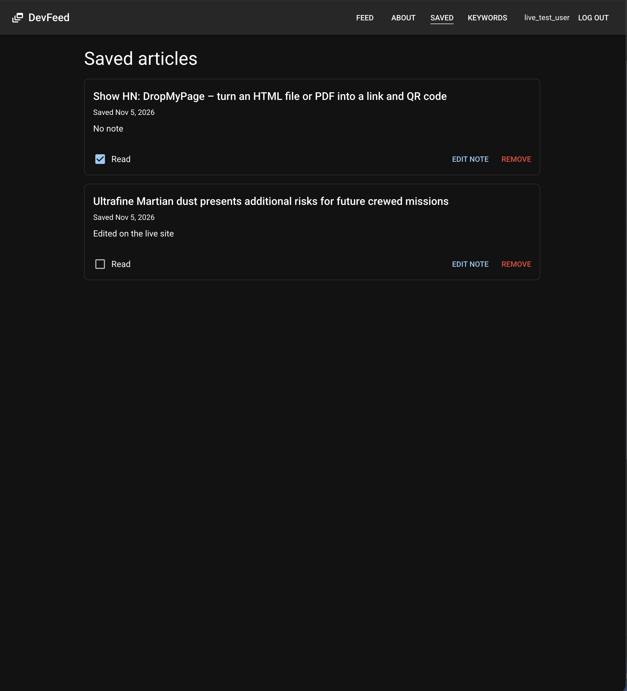
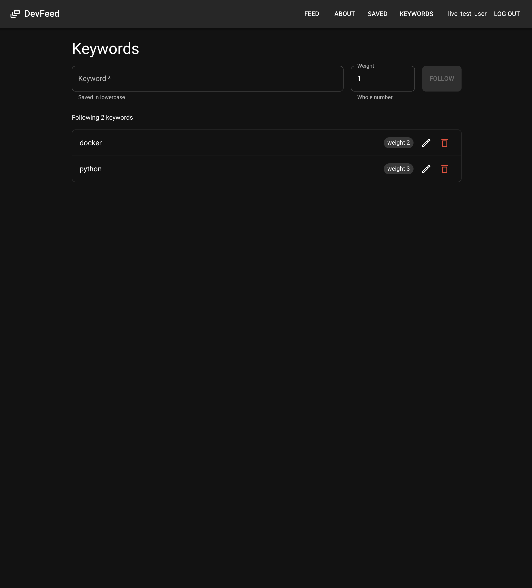
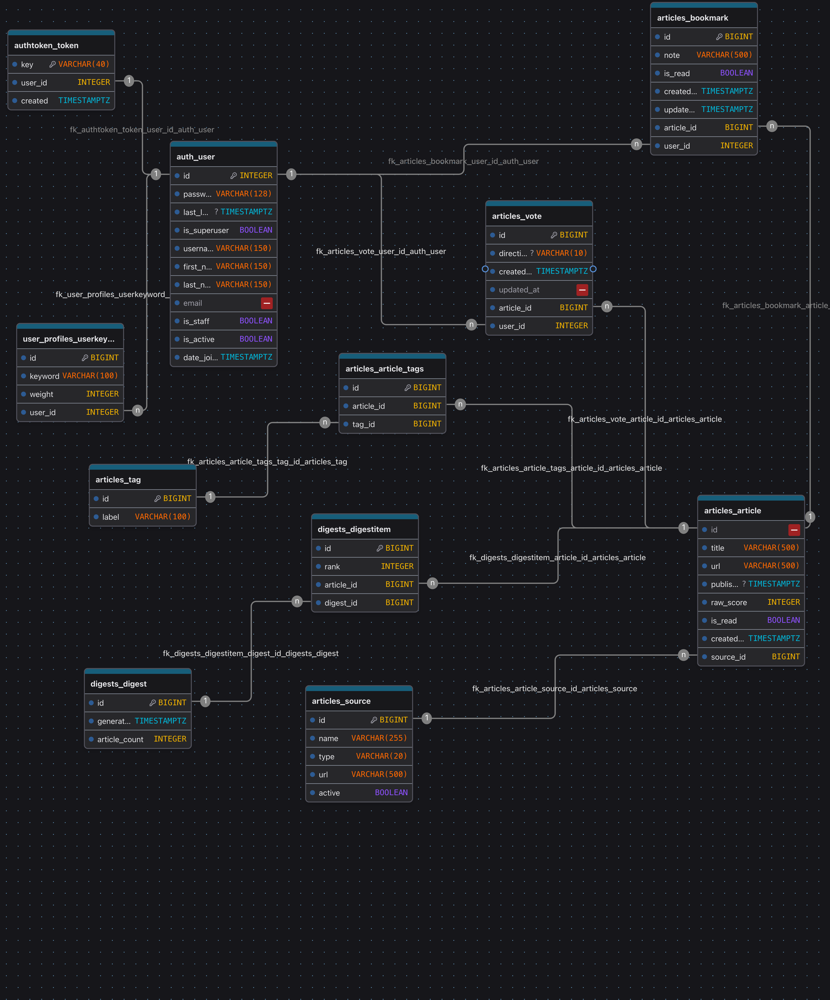

# DevFeed

One feed for developer news. DevFeed pulls stories from the Hacker News and GitHub APIs into one PostgreSQL database, and a React + Material UI web app reads them through a Django REST Framework API. I can save articles with notes and follow the keywords I care about, from the web app or from the `devfeed` command-line client, which uses the same API.

I built DevFeed as my Module 9 personal project for Code Platoon (Cohort Juliett).

**Live site:** [http://44.248.236.123](http://44.248.236.123) (plain HTTP on one AWS EC2 instance; see [Known limitations](#known-limitations))

## Screenshots

The feed: the newest stories from Hacker News and GitHub, 20 per page, with a Save button on each card when logged in.



Saved articles: each bookmark shows its note and saved date, with a Read checkbox, Edit note and Remove.



Keywords: follow a keyword with a weight, then edit or stop following it.



## Features

1. Sign up, log in and log out (Django users with DRF token authentication).
2. A paginated feed of articles from two third-party APIs: the Hacker News Algolia API and the GitHub Search API, loaded by management commands.
3. Bookmarks, with full CRUD from the UI: save an article with an optional note, list saved articles, edit the note, mark it read, and remove it.
4. Followed keywords, with full CRUD from the UI: follow a keyword with a weight, list them alphabetically, edit the text or weight, and stop following.
5. Each user sees and changes only their own bookmarks and keywords; another user's row returns 404.
6. Light and dark themes that follow the browser's color-scheme setting.
7. A command-line client, `devfeed`, for the feed, bookmarks, keywords and article voting, plus a command that opens the matching web page (see [Command-line client](#command-line-client)).

Article voting is in the API and the CLI, not in the web UI yet. Tag autocomplete (`GET /api/search/autocomplete/`) is built in the API only. Both are part of the [next phase](#next-phase).

## Tech stack

| Layer | Technology |
| --- | --- |
| Frontend | React 19, Vite 8, Material UI 9, React Router 8 (JavaScript) |
| Command-line client | Python 3.14 with `argparse` and `requests` (no extra dependencies) |
| Backend | Python 3.14, Django 6.1, Django REST Framework, django-cors-headers, Gunicorn |
| Database | PostgreSQL 18 (Docker) |
| Third-party APIs | Hacker News Algolia API, GitHub Search API |
| Containers | Docker, Docker Compose (three services: `db`, `backend`, `frontend`) |
| Web server | NGINX (serves the React build and proxies `/api/` to Django on the same origin) |
| Hosting | AWS EC2 (`t3.small`, Ubuntu 24.04 LTS) |

## Data model (ERD)



The main tables:

1. `articles_source`: where an article came from (Hacker News or GitHub).
2. `articles_article`: one story or repository, with a unique URL, linked to its source and to many tags.
3. `articles_tag`: labels, joined to articles through `articles_article_tags` (many-to-many).
4. `articles_bookmark`: a user's saved article with a note and a read flag; one bookmark per user and article.
5. `user_profiles_userkeyword`: a keyword a user follows, with a weight; one row per user and keyword, stored in lowercase.
6. `articles_vote`: a user's up or down vote on an article.

The diagram source is [`docs/devfeed_erd.json`](docs/devfeed_erd.json) (drawdb.app).

## Running DevFeed locally

Two ways to run it: with Docker Compose (closest to production), or with a local Python and Node setup (best for development, with live reload). Both start from a clone:

```zsh
git clone https://github.com/BigZeeke/devfeed.git
cd devfeed
cp .env.example .env
```

`.env` is untracked and holds secrets. `.env.example` lists every variable with a comment, including the command that generates each secret.

### Option 1: Docker Compose

Requires Docker with the Compose plugin.

1. In `.env`, set `SECRET_KEY` and `POSTGRES_PASSWORD` using the generator commands in the comments above them. `POSTGRES_DB` and `POSTGRES_USER` can stay `devfeed`. Leave `FRONTEND_HOST_BINDING` empty.
2. Build and start the three containers:

   ```zsh
   docker compose up --build --detach
   ```

3. Create the tables (migrations are a manual step):

   ```zsh
   docker compose exec backend python manage.py migrate
   ```

4. Load articles from both APIs:

   ```zsh
   docker compose exec backend python manage.py ingest_hacker_news
   docker compose exec backend python manage.py ingest_github
   ```

5. Open `127.0.0.1:8080` in a browser and sign up.

`docker compose stop` stops the containers and keeps the data. `docker compose down --volumes` deletes the database.

### Option 2: Local development (Django runserver + Vite)

Requires Python 3.14, Node 26 and a local PostgreSQL server.

1. Create a database, for example with `createdb devfeed`.
2. In `.env`, set:
   1. `SECRET_KEY`, using the generator command in the comment above it.
   2. `DATABASE_URL`, pointing at that database (`postgres://<user>:<password>@localhost:5432/devfeed`).
   3. `DEBUG=True`.
   4. `CORS_ALLOWED_ORIGINS=http://localhost:5173,http://127.0.0.1:5173`, so the Vite dev server can call the API.
3. Install the backend, create the tables, load articles and start the API at `127.0.0.1:8000`:

   ```zsh
   python -m venv .venv
   source .venv/bin/activate
   pip install -r devfeed_api/requirements.txt
   cd devfeed_api
   python manage.py migrate
   python manage.py ingest_hacker_news
   python manage.py ingest_github
   python manage.py runserver
   ```

4. In a second terminal, from the repo root, install and start the frontend:

   ```zsh
   cd frontend
   npm ci
   npm run dev
   ```

5. Open `localhost:5173` in a browser.

`ingest_github` reads an optional `GITHUB_PERSONAL_ACCESS_TOKEN` from `.env`; without one it runs at GitHub's lower unauthenticated rate limit. Both ingestion commands accept `--limit`, and rerunning them doesn't duplicate articles.

### Tests

The backend has 102 tests (ingestion, permissions, auth, articles, bookmarks, keywords, votes, search and environment config). From `devfeed_api/`:

```zsh
python manage.py test
```

In Docker: `docker compose exec backend python manage.py test`. The frontend has a linter (`npm run lint` in `frontend/`) but no automated tests yet.

The command-line client has 86 unit tests that mock the API, so they run without a server. From the repo root, after installing the CLI (next section):

```zsh
python -m unittest discover -s cli/tests
```

## Command-line client

`devfeed` is a thin client over the same REST API as the web app. It lives in `cli/` and needs nothing beyond the backend's requirements.

### Install

From the repo root, with the virtual environment from Option 2 active:

```zsh
pip install -e cli
devfeed --help
```

### Choosing a server

Every command talks to `127.0.0.1:8000` (local `runserver`) unless told otherwise:

1. `--api-url <address>` on any command, for example `devfeed --api-url 127.0.0.1:8080 feed` for the Docker stack.
2. `DEVFEED_API_URL` in the environment, used when `--api-url` isn't given.

Log-ins are stored per server in `~/.config/devfeed/sessions.json` (readable only by me), so I can be logged in locally and on the live site at the same time. Tokens are never printed.

### Commands

| Command | What it does |
| --- | --- |
| `devfeed login` / `logout` / `whoami` | Log in (asks for username and password), log out, or show who is logged in on this server |
| `devfeed feed [--page N]` | List articles, newest first, 20 per page |
| `devfeed show <article-id> [--open]` | Show one article's details; `--open` also opens its link |
| `devfeed open <article-id>` | Open an article's link in the browser |
| `devfeed save <article-id> [--note TEXT]` | Save an article as a bookmark |
| `devfeed saved [--page N]` | List my bookmarks with their bookmark ids, read flag and note |
| `devfeed note <bookmark-id> TEXT` | Replace a bookmark's note (`""` clears it) |
| `devfeed unsave <bookmark-id> [--yes]` | Remove a bookmark |
| `devfeed keywords` | List my followed keywords and weights |
| `devfeed keywords follow <word> [--weight N]` | Follow a keyword (weight defaults to 1) |
| `devfeed keywords unfollow <word> [--yes]` | Stop following a keyword |
| `devfeed vote <article-id> up\|down` | Vote on an article; voting again switches the vote |
| `devfeed unvote <article-id> [--yes]` | Take back my vote |
| `devfeed web [feed\|saved\|keywords] [--web-url URL]` | Open the matching web app page |

Notes:

1. Saving uses the article id from `feed`; `note` and `unsave` use the bookmark id from `saved`.
2. `unsave`, `keywords unfollow` and `unvote` ask `[y/N]` first; only `y` or `yes` goes ahead, and `--yes` skips the question.
3. `devfeed web` opens `localhost:5173` for local `runserver`, and the API's own address otherwise (the live site and the Docker stack serve the web app and the API together). The browser keeps its own log-in, so it's logged in separately.
4. Exit codes: 0 on success, 1 on an error (with a one-line message), 2 for a mistyped command.

## API overview

All endpoints are under `/api/`. Authenticated requests send `Authorization: Token <key>`. List responses are paginated, 20 per page: `{count, next, previous, results}`.

| Endpoint | Methods | Who |
| --- | --- | --- |
| `/api/auth/register/`, `/api/auth/token/`, `/api/auth/logout/` | POST | Anyone (log-out needs a token) |
| `/api/articles/`, `/api/sources/`, `/api/tags/` | GET (staff can also write) | Anyone |
| `/api/bookmarks/` | GET, POST, PUT, PATCH, DELETE | Logged-in users, own rows only |
| `/api/keywords/` | GET, POST, PUT, PATCH, DELETE | Logged-in users, own rows only |
| `/api/articles/<id>/vote/` | POST `{"direction": "up" \| "down" \| null}` | Logged-in users |
| `/api/search/autocomplete/?field=tag&query=<text>` | GET | Anyone |

## Next phase

These five features are in my approved proposal's MVP but not in the web app yet. I chose not to add them before the presentation, because the web app is fully working and I didn't want to disturb it; they're the planned next phase, in this order:

1. **GitHub Trending banner** on the home page. GitHub repositories are already ingested with the source "GitHub"; this is mostly UI.
2. **"My feed"**, a feed driven by the keywords I follow. Needs a new backend filter and a page.
3. **Voting UI**: thumbs up and down on each article, with switching and taking a vote back. The endpoint is built and tested, and the CLI already uses it; this is UI only.
4. **Article detail page**. Mostly UI; the article endpoint already returns one article.
5. **Tag filtering with autocomplete**: type `dja`, pick `django`, and filter the feed. The autocomplete endpoint is built and tested, but the article list has no tag filter yet and ingestion doesn't assign tags, so this needs backend work.

## Known limitations

1. The live site runs on plain HTTP at a bare IP address, so passwords and tokens travel unencrypted. HTTPS with a domain is planned.
2. The log-in token is stored in the browser's `localStorage` and doesn't expire until log-out.
3. GitHub results aren't filtered, so off-topic repositories can appear in the feed.
4. Keywords and votes don't filter or rank the feed yet.
5. Ingestion runs by hand with the management commands; there's no schedule yet.
6. The Django admin loads without its CSS under Gunicorn (static files aren't collected yet).
7. The web app and the CLI share one log-in token per user, so `devfeed logout` also logs the browser out when both use the same account.

## Project documents

1. [Project proposal](docs/proposal.md)
2. [Design document](docs/devfeed_design_document.md)
3. [Build checklist and current status](docs/fullstack_build_checklist.md)
