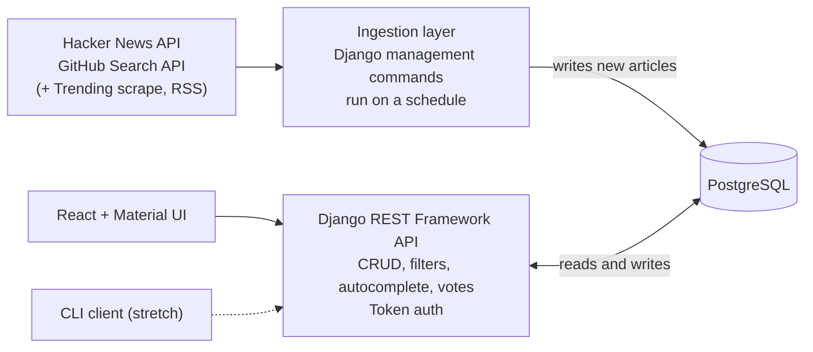

# DevFeed — Project Proposal

**Steve Lopez ([@BigZeeke](https://github.com/BigZeeke)) · Repo: [github.com/BigZeeke/devfeed](https://github.com/BigZeeke/devfeed)**

> One feed for developer news. DevFeed pulls stories from Hacker News and GitHub into a single PostgreSQL database, lets each user filter by the languages and frameworks they follow, save articles with personal notes, and rank articles with thumbs-up/down votes, from a React web app on top of a Django REST API, deployed with Docker on AWS EC2.

**Where it stands today:** the backend foundation is already built and verified on real Postgres. All models are migrated, Hacker News ingestion is live (40 real articles, deduplicated by a unique constraint on the URL), and the CRUD API for sources, tags and articles is working and paginated. The three build weeks go to the features, the frontend and the deploy.

---

## 1. What is the app and what problem does it solve?

Developers follow news across Hacker News, GitHub, blogs and newsletters, each with its own format and noise level. Keeping up means a handful of open tabs and a lot of skimming past things that don't apply.

DevFeed collects those sources into one feed. A user follows keywords and tags (say `django`, `postgres`, `react`), filters the feed down to what matters to them, saves articles to read later with a short note, and votes articles up or down so the ranking reflects what they find useful. GitHub's trending repositories sit in a banner across the top of the homepage.

## 2. Who is the target user?

Working developers and bootcamp students who want one filtered view of developer news instead of five sites. That includes terminal-first developers like me, which is why the API is designed so a command-line client can use it later (stretch goal).

## 3. Core features (MVP)

- **Sign up, log in, log out** with Django's built-in users and DRF token authentication.
- **Aggregated article feed** from two third-party APIs (Hacker News and GitHub), paginated, newest first.
- **Tag filtering with server-side autocomplete**: type `dja`, get `django`; pick it to filter the feed.
- **Followed keywords (full CRUD in the UI):** add, list, rename and delete the keywords that drive a "My feed" view. Users only see and change their own.
- **Bookmarks (full CRUD in the UI):** save any article, see my saved list, edit a personal note (up to 500 characters) and mark it read, and remove it. Users only see and change their own.
- **Voting:** thumbs up/down on any article, switch the vote, or take it back.
- **GitHub Trending banner** on the homepage.
- **React + Material UI frontend** with navigation between the feed, article detail, saved, keywords and login pages.
- **Deployed to AWS EC2 with Docker Compose** (Postgres, Django/Gunicorn, React served by nginx), with a first deploy in Week 23.

## 4. Stretch goals (if time permits)

1. **CLI client** on the same API (`devfeed feed --tag django`, `devfeed vote 42 up`); already designed.
2. **Personal digests** built from each user's followed keywords.
3. **RSS ingestion** for Real Python and InfoQ (fetcher already built and tested).
4. **Free-text search** across titles and sources.
5. **LLM re-ranking** of the feed from each user's vote history (deliberately a stretch goal, not part of the MVP).

## 5. ERD / Schema design


Drawn from the live Postgres schema. Seven custom models across three Django apps today, plus the Bookmark model to build, Django's built-in user and DRF's token table:

| App | Model | Key relationships |
| --- | --- | --- |
| articles | Source | One Source has many Articles |
| articles | Article | Belongs to a Source; many-to-many with Tag; `url` is unique |
| articles | Tag | Many-to-many with Article; `label` is unique |
| articles | Vote | Belongs to a User and an Article; one vote per user per article |
| articles | Bookmark (to build) | Belongs to a User and an Article; one bookmark per user per article; note up to 500 characters; per-user read flag |
| user_profiles | UserKeyword | Belongs to a User; one row per user per keyword |
| digests | Digest | Has many Articles through DigestItem |
| digests | DigestItem | Join model between Digest and Article, with a `rank` |
| (Django) | auth_user, authtoken_token | One token per user |

The MVP requirement is at least two models with a relationship; DevFeed has eight, with one-to-many, many-to-many and one-to-one relationships. Full CRUD from the React UI covers two user-owned models, **UserKeyword** and **Bookmark**, on top of the existing CRUD API for sources, tags and articles.

## 6. Wireframes

```text
FEED (HOME)
+------------------------------------------------------+
| DevFeed  Feed · My feed · Saved · Keywords · Log in  |
+------------------------------------------------------+
| [ Trending banner: repo cards, scrolls sideways -> ] |
| [ Tag search (autocomplete)      ] [ Source v ]      |
| +-----------------------+ +-----------------------+  |
| | Article title         | | Article title         |  |
| | Source, 2h ago        | | Source, 5h ago        |  |
| | Tags: django, react   | | Tags: rust            |  |
| | Up / down · Save      | | Up / down · Save      |  |
| +-----------------------+ +-----------------------+  |
|            Previous · 1 · 2 · 3 · Next               |
+------------------------------------------------------+

ARTICLE DETAIL
+------------------------------------------------------+
| DevFeed  Feed · My feed · Saved · Keywords · Log in  |
+------------------------------------------------------+
| Article title                                        |
| Hacker News, 3 hours ago                             |
| Tags: django, postgres                               |
| Score 42 · Thumbs up / down                          |
| [ Open original ]   [ Save ]                         |
|                                                      |
| Back to feed                                         |
+------------------------------------------------------+

LOG IN / SIGN UP DIALOG
+------------------------------------------------------+
| DevFeed  Feed · My feed · Saved · Keywords · Log in  |
+------------------------------------------------------+
|      +------------------------------------+          |
|      |  [Log in]   Sign up                |          |
|      |  [ Username                     ]  |          |
|      |  [ Email (sign up only)         ]  |          |
|      |  [ Password                     ]  |          |
|      |  [            Log in            ]  |          |
|      +------------------------------------+          |
+------------------------------------------------------+

KEYWORDS
+------------------------------------------------------+
| DevFeed  Feed · My feed · Saved · Keywords · Log out |
+------------------------------------------------------+
| My keywords                                          |
| [ New keyword                  ] [ Add ]             |
| ( django x ) ( postgres x ) ( rust x )               |
|                                                      |
| Click a chip to rename it                            |
| My feed shows articles matching these                |
+------------------------------------------------------+

SAVED
+------------------------------------------------------+
| DevFeed  Feed · My feed · Saved · Keywords · Log out |
+------------------------------------------------------+
| Saved articles                                       |
| +--------------------------------------------------+ |
| | Article title                                    | |
| | Note: read before the Django upgrade             | |
| | [x] Read · Edit note · Remove                    | |
| +--------------------------------------------------+ |
| | Article title                                    | |
| | Add a note (500 characters max)                  | |
| | [ ] Read · Edit note · Remove                    | |
| +--------------------------------------------------+ |
+------------------------------------------------------+
```

## 7. Third-party APIs

- **Hacker News Algolia Search API** (`hn.algolia.com/api/v1/search_by_date`): the main source of articles. Already integrated: a Django management command fetches the latest stories and saves them, skipping any URL already stored.
- **GitHub Search API** (`api.github.com/search/repositories`): repositories for the trending banner and the feed. The fetcher is built and tested; next step is wiring it into a management command like Hacker News. An optional personal access token raises the rate limit.

Beyond the two required APIs, DevFeed also scrapes GitHub's trending page (it has no official API) and has an RSS fetcher for Real Python and InfoQ.

**Question for you:** ingestion runs as scheduled Django management commands, which fill the database from both APIs; the React app then reads from my own API. Does that count as integrating the two third-party APIs, or would you want at least one called live during a user request?

---

## Architecture



- **One API, one source of truth.** Every client goes through the Django REST API; nothing talks to the database directly.
- **Ingestion is separate from requests.** Third-party APIs are called on a schedule, not on every page load, which keeps the app fast and well inside rate limits.
- **Deployment:** three Docker Compose services on one EC2 instance. Postgres keeps its data in a named volume, Django runs under Gunicorn, and nginx serves the React build and proxies `/api/`, so the frontend and API share one origin.
- **Configuration:** all secrets in `.env`, documented in a committed `.env.example`.

**Stack:** React, Material UI, Vite · Django REST Framework · PostgreSQL · Docker Compose, nginx · AWS EC2
